  

<h1 align="center">Hey, I'm Shreepal 👋</h1>

  <strong>Indie builder · Product-minded developer · AI explorer</strong>

  I like turning ideas into useful products. 
  I build web apps, experiment with AI workflows, and share what I learn along the way.

  
  

---

### 🧑‍💻 About me

- 🚀 Building small products, tools, and experiments on the web.
- 🤖 Exploring practical AI applications and workflows.
- 🧩 Interested in product thinking, developer experience, and useful software.
- 🌱 Currently sharpening my skills in TypeScript, React, Next.js, and backend development.
- 🤝 Interested in meeting thoughtful builders and collaborating on ambitious ideas.

### 🔭 What I'm working on

| Project | What it is |
| --- | --- |
| **Research Copilot** | An AI-assisted workflow for researching and organizing information. |
| **Spec Whisper** | Turns voice rambles into structured product and build specifications. |
| **TechGenerous** | A publication about AI tools, technology, and software. |

*Some projects are experiments and works in progress.*

### 🛠️ Tools I use

  

### 📊 GitHub at a glance

  
  

  

---

  <i>Build useful things. Stay curious. Keep shipping.</i>

